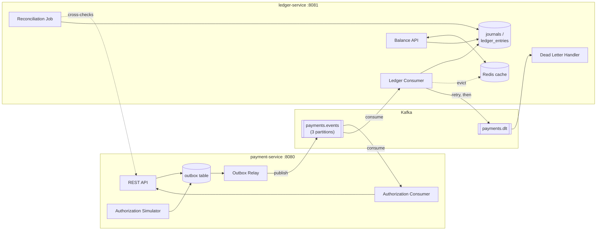

# ledger-flow

An event-driven payment settlement and ledger system, built to demonstrate
Kafka-based service decoupling, the transactional outbox pattern, and
double-entry accounting — with Redis-cached reads and Postgres as the
source of truth throughout.

> 💡 **New to these concepts?** See [HOW_IT_WORKS.md](HOW_IT_WORKS.md) for a beginner-friendly explanation using simple terms and real-world analogies.

Two Spring Boot services communicate exclusively through Kafka: a payment
is created, authorized asynchronously, and booked into a double-entry
ledger, all without either service calling the other directly over HTTP.

## Architecture



## What this demonstrates

- **Transactional outbox pattern** — `payment-service` writes a payment and
  its outbound event(s) in one DB transaction, so a crash between "save
  payment" and "publish to Kafka" can't lose an event. A scheduled relay
  polls the outbox and publishes to Kafka independently.
- **Double-entry accounting** — every booked payment produces a balanced
  journal: one debit, one credit, same amount, enforced in code and
  asserted directly in tests.
- **Simulated async authorization** — `payment-service` decides an
  authorization outcome and routes it back through Kafka rather than
  updating the payment synchronously, so a client sees `PENDING` first and
  the real status a moment later — genuine eventual consistency, not just
  a fast in-request update.
- **Idempotent consumers** — every consumer dedupes via a
  `processed_events` table keyed by `(event_id, consumer_group)`, so
  Kafka's at-least-once delivery can never double-book a payment.
- **Cache-aside balances** — account balances are computed from
  `ledger_entries` on a cache miss, cached in Redis with a TTL, and
  actively evicted the moment new entries are booked.
- **DLQ handling** — a message that fails processing gets a couple of
  quick retries, then is routed to `payments.dlt` instead of blocking
  every message behind it on the same partition; a dedicated handler
  records what failed and why.
- **Reconciliation** — a scheduled job cross-checks `payment-service`'s
  payments against `ledger-service`'s booked journals and flags drift
  (e.g. a payment whose event was dead-lettered instead of booked).

## Stack

Java 21 · Spring Boot 4.1 · Maven · Kafka (KRaft) · PostgreSQL 16 · Redis 8
· Flyway · Testcontainers

## Project structure

```
payment-service/   REST API, outbox relay, authorization simulator + consumer
ledger-service/    ledger consumer, balance API, reconciliation, DLQ handler
ledger-frontend/   React + TypeScript + Vite operations console
docker-compose.yml Kafka, Postgres, Redis
```

Money is always stored as `BIGINT` minor units (cents) — never `DECIMAL`
or floating point.

## Getting started

**Prerequisites:** Docker, Java 21.

1. Start the infrastructure:
   ```bash
   docker compose up -d
   ```
2. Start each service, from its own directory:
   ```bash
   cd payment-service && ./mvnw spring-boot:run
   ```
   ```bash
   cd ledger-service && ./mvnw spring-boot:run
   ```
3. (Optional) Start the frontend operations console:
   ```bash
   cd ledger-frontend && npm install && npm run dev
   ```
   Open `http://localhost:5173` in your browser.

Each service reads its own `application.yml` and manages its own Flyway
migrations against the shared Postgres database, tracked in separate
history tables so the two never collide.

## Trying it out

Create a payment:
```bash
curl -X POST localhost:8080/payments \
  -H "Content-Type: application/json" \
  -d '{"idempotencyKey":"demo-1","amountMinor":5000,"currency":"USD"}'
```

Check its status a moment later — it starts `PENDING` and flips to
`AUTHORIZED` (or `FAILED`, for amounts over the configured limit) once the
outbox relay and Kafka round-trip complete:
```bash
curl localhost:8080/payments/{id}
```

Check the resulting ledger balances:
```bash
curl localhost:8081/accounts
curl localhost:8081/accounts/PSP_RECEIVABLE/balance
```

## API reference

**payment-service** (`:8080`)
| Method | Path | Description |
|---|---|---|
| `POST` | `/payments` | Create a payment (idempotent on `idempotencyKey`) |
| `GET` | `/payments/{id}` | Fetch a payment's current status |

**ledger-service** (`:8081`)
| Method | Path | Description |
|---|---|---|
| `GET` | `/accounts` | List seeded ledger accounts |
| `GET` | `/accounts/{code}/balance` | Cached account balance (DR/CR net) |
| `GET` | `/reconciliation/reports` | Recent reconciliation mismatches |
| `POST` | `/reconciliation/run` | Trigger reconciliation on demand |

## Testing

Each service has fast Mockito-based unit tests alongside Testcontainers
integration tests that spin up real Kafka, Postgres, and Redis to
exercise the actual event pipeline end-to-end:

```bash
./mvnw clean verify
```

Docker must be running.

## Design notes

A few deliberate simplifications, since this is a demo/portfolio project
rather than a production system:

- Both services share one physical Postgres database (a real deployment
  would give each its own). `processed_events` is intentionally shared
  infrastructure between them; `ledger-service`'s reconciliation job reads
  `payment-service`'s `payments` table directly rather than over HTTP.
- The ledger books a payment's journal entries immediately on creation,
  not gated on the authorization outcome — accounting-simplified in favor
  of a fully working, demoable pipeline.
- The DLQ path is single-hop (straight to `payments.dlt` after a couple of
  quick retries), not a separate retry-topic hop.
